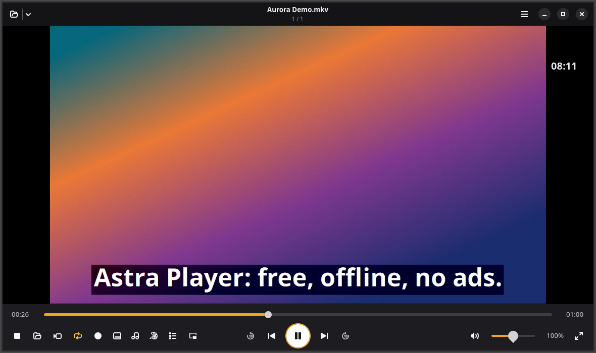
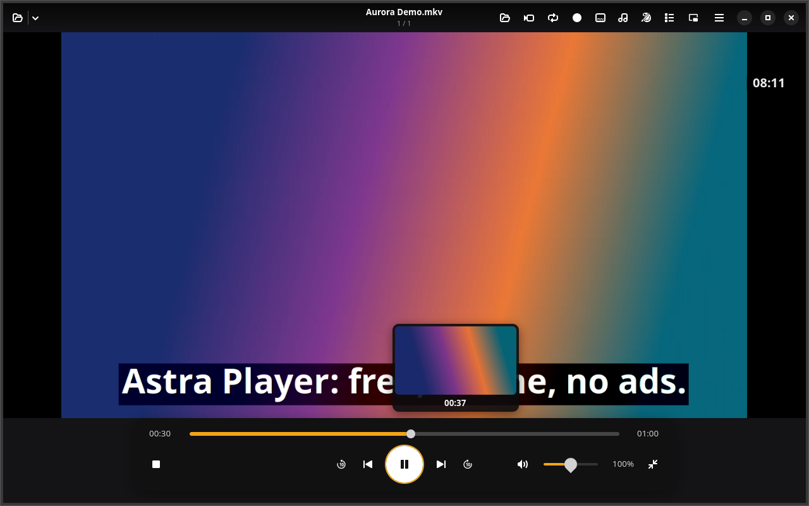

<div align="center">


# Astra Player

**A free, PotPlayer-style media player for Linux.**<br>
No ads. No account. No subscription. No codec packs to hunt for later.

[](https://github.com/Hafij-DEU/video-player/releases/latest)
[](LICENSE)


[Download](https://github.com/Hafij-DEU/video-player/releases/latest) ·
[Features](#features) ·
[Hotkeys](#hotkeys) ·
[YouTube help](#youtube) ·
[Android app](https://github.com/Hafij-DEU/astra-player-android)



</div>

## Why Astra Player

- **Every codec on install.** H.264, HEVC, AV1, VP9, ProRes, DTS, TrueHD and
  more come in with the package dependencies. VA-API hardware decoding is used
  when the GPU supports it.
- **Streams and YouTube built in.** Search YouTube from the player, keep
  playlists of what you find, and save videos or live streams to disk.
- **Subtitles done right.** Found automatically in the video's folder, two at
  once, modern styling, and offline speech-to-subtitles with Whisper.
- **Familiar.** PotPlayer-style hotkeys and controls, rewritten from scratch
  for GTK 4. It contains no PotPlayer code.
- **Private.** Nothing is downloaded or read from your browser without asking.

## Install

Download the latest `.deb` from
[Releases](https://github.com/Hafij-DEU/video-player/releases/latest) and
install it with apt, which also pulls in every codec:

```bash
sudo apt install ./astra-player_1.7.2_all.deb
```

**Requirements:** a Debian or Ubuntu system with Python 3.10+, GTK 4.14+ and
libadwaita 1.5+. Developed and tested on Ubuntu 26.04.

After that, Astra Player checks GitHub once a day and offers one-click
updates. Turn this off in Preferences.

<details>
<summary><b>Build the package from source</b></summary>

```bash
git clone https://github.com/Hafij-DEU/video-player.git
cd video-player
./packaging/build-deb.sh                 # writes dist/astra-player_<version>_all.deb
sudo apt install ./dist/astra-player_*_all.deb
```

Or run it straight from the source tree without installing:

```bash
python3 -m astra_player video.mkv
```

</details>

<details>
<summary><b>What the package installs</b></summary>

| | Packages |
| --- | --- |
| **Required** | GStreamer base, good, bad and ugly plugins, `gstreamer1.0-libav` (FFmpeg), `gstreamer1.0-gtk4`, `gstreamer1.0-gl`, GTK 4 and libadwaita bindings |
| **Recommended** | `gstreamer1.0-plugins-extra` (VA-API), `gstreamer1.0-pipewire`, `yt-dlp`, `ffmpeg`, `whisper.cpp`, `python3-secretstorage` |
| **Suggested** | `libggml0-backend-vulkan` (Whisper on the GPU) |

apt installs recommended packages by default, so updates also bring in any new
extras.

</details>

*Upgrading from Kiln Player?* Astra Player replaces the `kiln-player` package
and keeps your settings, resume points and Whisper models.

## Features



<sub>Fullscreen: a compact control panel at the bottom, the other options in
the top bar, and a preview frame while you hover the seek bar.</sub>

### Playback

- **Formats:** H.264, HEVC/H.265, AV1, VP8/VP9, MPEG-1/2/4, VC-1/WMV, ProRes,
  Theora; AAC, MP3, AC-3, E-AC-3, DTS, TrueHD, FLAC, ALAC, Opus, Vorbis, WMA,
  APE, WavPack; MKV, MP4, MOV, AVI, TS/M2TS, WebM, FLV, OGG and more.
  A file that can't be played just says "Unsupported file".
- **Controls:** speed 0.1×–8× with pitch correction, A-B repeat, frame stepping
  forward and back, chapters, ±10 s buttons, and resume where you left off.
- **Repeat and shuffle:** one button cycles play once, repeat file and repeat
  playlist.
- **Seek preview:** hover the seek bar to see a frame from that point.
- **Fullscreen:** a small see-through panel centred at the bottom, and a
  clock in the corner (Menu › Clock: fullscreen only, always, or off).
- **Picture in picture** (Ctrl+P): a small borderless window you can drag and
  resize. Hover it for back 10 s, play/pause, forward 10 s, back to the window,
  back to fullscreen, and close.

### Streams and YouTube

- **Streams:** HTTP, HLS, DASH and RTSP, plus YouTube and many other sites
  through `yt-dlp`.
- **YouTube search** (Ctrl+Y): results with thumbnails, channel, length and
  views. No API key and no account needed. Typing `ytsearch:words` in Open URL
  runs the same search.
- **Saved playlists** (Ctrl+B): save one search result, all of them, or the
  current queue into named playlists. Play, rename, reorder or delete them at
  any time.
- **Save streams** (Ctrl+S): download a whole video, or record a live stream
  until you stop it (Playback › Cancel saving).
- **Record a portion** (Ctrl+R): press once to start and again to stop, or set
  A and B. *Fast* copies the streams losslessly to the nearest keyframe;
  *Precise* re-encodes to MP4 on the exact frame. Works for YouTube too.

### Subtitles

- **Formats:** embedded tracks and external `.srt` `.ass` `.ssa` `.vtt` `.sub` `.smi`.
- **Found automatically** in the video's folder or a `Subs`/`Subtitles`
  subfolder: same name, name plus language (`movie.en.srt`), the same episode
  code (`S01E02`, `1x02`, `Ep02`), or the only subtitle beside the only video.
  Every match is listed under Subtitles › *Subtitle files in this folder*.
- **Two subtitles at once** (Subtitles › *Second subtitle*), at the top or
  just above the first. Handy for language learning.
- **Style:** modern box or classic outline; white, yellow or cyan; four sizes;
  adjustable height (Alt+Up / Alt+Down). In fullscreen they rise above the
  controls.
- **Speech to subtitles:** Subtitles › *Generate subtitles (Whisper)…* turns
  the speech in a file into `<name>.whisper.srt`, offline, and loads it. Pick
  the model (tiny 78 MB, base 148 MB, small 488 MB), the spoken language, and
  optional translation to English.

### Audio and video

- **Audio:** track switching, 10-band equalizer with presets, volume up to
  200%, audio delay, and a visualization for music.
- **Video:** brightness, contrast, saturation and hue; rotate and flip
  (follows phone rotation tags); aspect-ratio presets; GLSL shaders (sharpen,
  soften, grayscale, sepia, night vision and more); screenshots.

### Library and desktop

- **Playlist:** adds the rest of the folder automatically, plays whole folders
  with subfolders (button, Ctrl+F, drag and drop, or *Open With* in Files), and
  reads and writes M3U, M3U8 and PLS.
- **Desktop integration:** MPRIS (media keys and GNOME/KDE media controls),
  no screen blanking while playing, single-window mode.

## Hotkeys

Press **F1** in the app for the full list. The most used:

| Key | Action |
| --- | --- |
| <kbd>Space</kbd> | Play / pause |
| <kbd>←</kbd> <kbd>→</kbd> | Seek 5 s (<kbd>Ctrl</kbd>: 30 s, <kbd>Shift</kbd>: 1 min) |
| <kbd>↑</kbd> <kbd>↓</kbd>, mouse wheel | Volume |
| <kbd>Enter</kbd>, double-click | Fullscreen |
| <kbd>Page Up</kbd> <kbd>Page Down</kbd> | Previous / next file (<kbd>Ctrl</kbd>: chapter) |
| <kbd>D</kbd> <kbd>F</kbd> | Previous / next frame |
| <kbd>X</kbd> <kbd>C</kbd> <kbd>Z</kbd> | Slower / faster / normal speed |
| <kbd>[</kbd> <kbd>]</kbd> <kbd>\\</kbd> | A-B repeat: set A / set B / clear |
| <kbd>,</kbd> <kbd>.</kbd> <kbd>/</kbd> | Subtitle delay − / + / reset |
| <kbd>Alt</kbd>+<kbd>↑</kbd> <kbd>Alt</kbd>+<kbd>↓</kbd> | Move subtitles up / down |
| <kbd>Alt</kbd>+<kbd>H</kbd>, <kbd>Alt</kbd>+<kbd>L</kbd>, <kbd>Alt</kbd>+<kbd>A</kbd> | Toggle subtitles, next subtitle, next audio track |
| <kbd>W</kbd><kbd>E</kbd> / <kbd>R</kbd><kbd>T</kbd> / <kbd>Y</kbd><kbd>U</kbd> / <kbd>I</kbd><kbd>O</kbd>, <kbd>Q</kbd> | Brightness / contrast / saturation / hue, reset |
| <kbd>Ctrl</kbd>+<kbd>O</kbd> / <kbd>F</kbd> / <kbd>U</kbd> / <kbd>V</kbd> | Open files / folder / URL / clipboard |
| <kbd>Ctrl</kbd>+<kbd>Y</kbd> | Search YouTube |
| <kbd>Ctrl</kbd>+<kbd>B</kbd> | Saved playlists |
| <kbd>Ctrl</kbd>+<kbd>S</kbd> | Save the video or stream |
| <kbd>Ctrl</kbd>+<kbd>R</kbd>, <kbd>Ctrl</kbd>+<kbd>Shift</kbd>+<kbd>R</kbd> | Record start/stop; save the A-B segment |
| <kbd>Ctrl</kbd>+<kbd>L</kbd> | Repeat: once / file / playlist |
| <kbd>Ctrl</kbd>+<kbd>P</kbd> | Picture in picture |
| <kbd>Ctrl</kbd>+<kbd>E</kbd> | Screenshot |
| <kbd>F6</kbd> / <kbd>F5</kbd> / <kbd>Ctrl</kbd>+<kbd>F1</kbd> / <kbd>Tab</kbd> | Playlist / preferences / media info / status |
| Right-click | Full menu |

## YouTube

<details>
<summary><b>“Sign in to confirm you’re not a bot”</b></summary>

YouTube sometimes rate-limits a connection (HTTP 429) and then refuses
anonymous playback. Astra Player then asks once whether it may use your
YouTube login from a browser on this computer: Brave, Chrome, Chromium, Edge,
Firefox, Opera or Vivaldi, including Snap and Flatpak installs. Pick one and
press **Allow**, and the video starts again where it was.

- If that browser isn't signed in, Astra Player tries your other browsers and
  remembers the one that works.
- yt-dlp reads the cookies on this computer and sends them only to YouTube.
- Nothing is read before you allow it. Change the choice, turn it off, or use
  a `cookies.txt` export in Preferences › YouTube.

If no browser works, sign in to YouTube in one of them and play the video
again, or wait a few hours for the limit to lift.

Chrome-based browsers keep their cookie key in the GNOME keyring, which
yt-dlp opens with the `secretstorage` Python module:

```bash
sudo apt install python3-secretstorage      # apt yt-dlp and Astra Player's own copy
pipx inject yt-dlp secretstorage            # a pipx yt-dlp
```

</details>

<details>
<summary><b>Keeping yt-dlp current</b></summary>

YouTube changes often, and an old yt-dlp is a common reason for playback to
fail. Turn on Preferences › YouTube › *Keep yt-dlp up to date* (or tick the
box in the sign-in dialog). Astra Player then:

1. Asks first, showing the size (about 3 MB).
2. Downloads the official yt-dlp from
   [its GitHub releases](https://github.com/yt-dlp/yt-dlp/releases).
3. Checks it against the release's `SHA2-256SUMS`.
4. Keeps it in `~/.local/share/astra-player/bin` and looks for a new release
   once a week.

Astra Player picks the yt-dlp best able to play YouTube: one that can solve
YouTube's JavaScript challenges and open the browser keyring. It uses Node.js,
Deno, Bun or QuickJS for the challenges, whichever is installed.

</details>

<details>
<summary><b>Speech to subtitles (Whisper)</b></summary>

Subtitle generation uses [whisper.cpp](https://github.com/ggml-org/whisper.cpp)
and runs on your own computer. Install one engine:

```bash
sudo apt install whisper.cpp                 # whisper-cli, CPU
sudo apt install libggml0-backend-vulkan     # optional: GPU through Vulkan
```

Without root, the Python binding works too:

```bash
pip install --user --break-system-packages pywhispercpp
```

The first time you generate subtitles, Astra Player asks before it fetches the
chosen model from huggingface.co and shows the size. Models are checked
against their SHA-256 and kept in `~/.local/share/astra-player/models`. Audio
is extracted with `ffmpeg` when installed, otherwise with GStreamer.

</details>

## Privacy

Astra Player has no telemetry and no account. It connects to the internet
only for:

- media you open from a URL or YouTube,
- the daily update check against GitHub (switch it off in Preferences),
- downloads you confirm: a Whisper model or the managed yt-dlp.

## Development

```
astra_player/
├── app.py, window.py      application and main window
├── engine.py              GStreamer playbin, GL video chain, subtitle styling
├── playlist.py            playlists, folder scan, subtitle matching
├── subparse.py            SRT/VTT/ASS parser for the second subtitle
├── thumbnailer.py         seek-preview frames from a second pipeline
├── youtube.py             yt-dlp, browser sign-in, search
├── export.py              recording, clipping and saving streams
├── whisper.py             speech to subtitles
├── updater.py             daily GitHub release check
└── pip.py, mpris.py, …    picture in picture, media keys
```

### Tests

The unit tests need no display and no network. They use canned `yt-dlp`
output, a local stand-in for GitHub, and never read browser cookies or write
to `~/.local/share`:

```bash
python3 -m unittest discover -s tests -p 'test_*.py'
```

The GUI end-to-end test generates its own media with `ffmpeg` and drives a
real window on a private X server. `dbus-run-session` keeps it from handing
off to an Astra Player already open on your desktop:

```bash
Xvfb :77 -screen 0 1280x800x24 &
DISPLAY=:77 GDK_BACKEND=x11 dbus-run-session python3 tests/gui_selftest.py
```

The speech-recognition checks run only when a Whisper engine and a downloaded
model are present. They use the spoken sample from the `whisper.cpp` package,
or the WAV file named by `ASTRA_SPEECH_WAV`. The tests never download a model.

## Related

- [Astra Player for Android](https://github.com/Hafij-DEU/astra-player-android):
  the same player for phones, with YouTube search and streaming.

## Credits and license

Built on [GStreamer](https://gstreamer.freedesktop.org/),
[FFmpeg](https://ffmpeg.org/), [GTK](https://gtk.org/) and
[libadwaita](https://gnome.pages.gitlab.gnome.org/libadwaita/), with
[yt-dlp](https://github.com/yt-dlp/yt-dlp) for streams and
[whisper.cpp](https://github.com/ggml-org/whisper.cpp) for speech recognition.

Astra Player is an independent project. It is not affiliated with PotPlayer or its
developers and contains none of their code.

Released under **GPL-3.0-or-later**. See [LICENSE](LICENSE).
